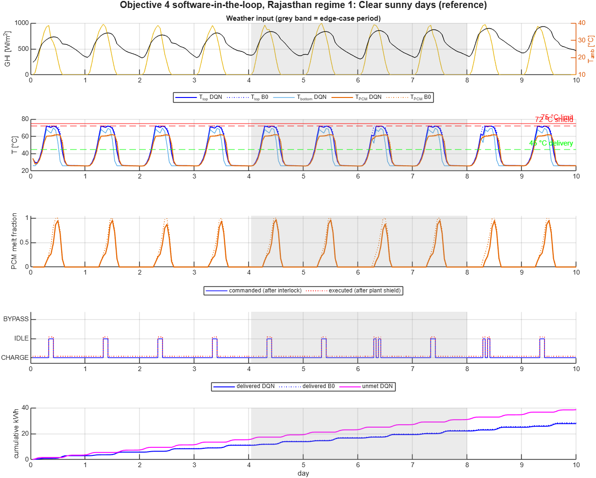
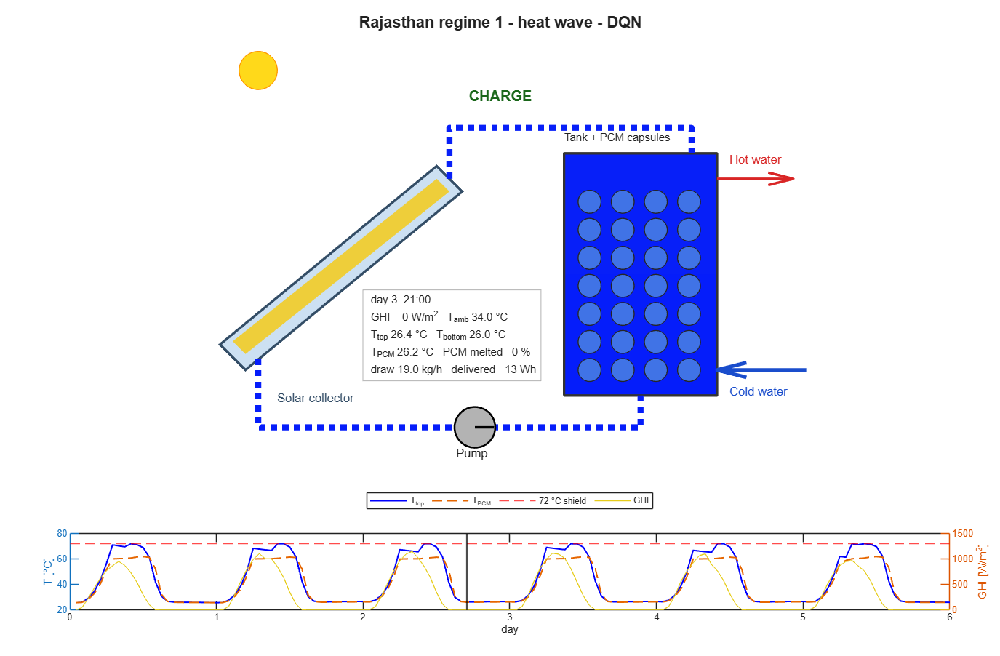

# Objective 4 (Rajasthan) – Points to Be Discussed

**One-line summary:** Objective 4 is done as a **software-in-the-loop (SIL) digital twin in MATLAB/Simulink**: the trained Objective 3 DQN controller is plugged into a simulated Rajasthan solar PCM water heater with noisy sensors and a safety interlock, and tested on normal and extreme weather. This is *emulated* validation, not experimental validation.

**State of the work today:** the MATLAB twin has been run in MATLAB R2026b for all three regimes: full-year validation, six scenarios, plots, and (for regime 1) animations. A Python copy of the same code (`sil_python_mirror.py`) gives the same numbers as a cross-check. The Simulink block diagram and the generated C code are not done, because the installed MATLAB has neither Simulink nor MATLAB Coder.

---

## 1. Objective 4 – Complete Explanation

### 1.1 What we are doing

1. **Objective 4 is the deployment check of the Objective 3 controller**, done in software.
2. **The whole control chain is replicated:** weather → sensors (with noise and dropout) → observation vector → DQN policy → safety interlock → pump/valve command → collector + stratified water tank + PCM capsules → hot-water outlet.
3. **The trained DQN is copied out of Python** as plain weight matrices, so exactly the same decision-maker runs in the twin.
4. **The plant is a line-by-line port** of the Objective 2 multi-node tank kernel that Objective 3 trains on, so the twin can be checked number-for-number against Python.
5. **It is stressed with edge cases:** no sunlight, rain/heavy cloud, very low temperature, heat wave, and a sensor failure with a 12-hour blackout. Each is compared with the always-charge baseline (B0).
6. **It is shown visually:** result plots for every case and animated schematics (sun, collector, pump, two-band tank, PCM capsules changing colour as they melt).
7. **What it proves and what it does not:** it proves the controller and its safety logic behave correctly on the modelled system outside the training code. It does not replace a physical test or a comparison with published experiments.

### 1.2 Inputs and datasets

| Input | Source |
|---|---|
| Plant parameters (50 L tank in 10 nodes, 1.5 m² collector, 52 capsules, PCM properties, safety limits 72 °C / 62 °C guard band and 75 °C / 65 °C hard) | Objective 2 Rajasthan design + Objective 3 contract v3 (`export_r*/plant_params.json`) |
| Weather: hourly irradiance (GHI), ambient temperature, hour of day, year 2023, 8760 h | Rajasthan point-year weather of each regime's medoid point (`export_r*/weather_2023.csv`) |
| Hot-water demand profile (24-hour draw pattern) | Objective 2 demand model |
| Trained DQN weights (MLP 17-64-64-3) | Objective 3 (`results/gen2/gen2_selected_dqn.json`, exported to JSON) |
| Python reference trajectory (for checking only) | Objective 3 environment run with the same policy |

| Regime | Medoid | PCM (melting point) | Water / PCM mass | Loop flow |
|---|---|---|---|---|
| 0 | Udaipur (RJP_0132) | savE OM55 (55 °C) | 35.8 kg / 12.5 kg | 0.0155 kg/s |
| 1 | Nagaur (RJP_0192) | PureTemp 60 (61 °C) | 35.2 kg / 13.4 kg | 0.0493 kg/s |
| 2 | Jaipur (RJP_0083) | PureTemp 58 (58 °C) | 35.2 kg / 12.4 kg | 0.0236 kg/s |

2023 is an Objective 3 **validation** year, not a held-out test year. The held-out years cannot be re-used: 2011–2015 belong to Objective 2's test and 2006–2010 are behind Objective 3's one-shot lock. No new data was collected for Objective 4.

### 1.3 What exactly is implemented or simulated

- **Weather source** feeding hourly sunlight and air temperature, plus the next three hours of sunlight as the forecast the policy expects.
- **Sensor model:** noise on irradiance (10 W/m² + 1 %), on air temperature (0.3 °C), on top, bottom and mean water temperature (0.2 °C) and on PCM temperature (0.5 °C); 1 % random dropout; optional blackout.
- **Observation builder:** the same 17-number state vector the controller was trained on.
- **DQN policy:** outputs CHARGE, IDLE or BYPASS each hour (the action with the largest Q-value).
- **Safety interlock:** stale sensor data forces BYPASS (fail-safe); a hard-limit breach latches a fault.
- **Plant:** linear collector with a differential controller, ten stacked water nodes (advection, conduction, stratified return, mixing), per-node PCM enthalpy model with melt fraction and wall heat capacity, per-node heat loss, and a safety shield that acts at every solver sub-step.
- **Demand and outlet:** hot water drawn from the top node at the demand profile, cold mains water entering the bottom node.

### 1.4 Algorithms and methods, and why

| Method | Why used | Alternatives considered |
|---|---|---|
| **DQN controller**, selected in Objective 3 | It is the released Rajasthan policy. On the validation years the regime 1 model keeps 98.2 % of B0's delivery with 57 % fewer shield hours (Objective 3 record) | SAC, PPO and rule-based baselines were trained in Objective 3; not re-opened here |
| **Software-in-the-loop** twin | Same code path as later processor- or hardware-in-the-loop stages | Hardware-in-the-loop (no rig) |
| **Multi-node tank + enthalpy-method PCM** | This is the model the policy was trained on; changing it would test a different system | Tamil Nadu's single-node plant (not what Rajasthan's policy saw), CFD (too slow for year-long loops) |
| **Sensor noise, dropout, stale-data interlock** | The realistic problems a deployed controller meets | Ideal sensors (too optimistic) |
| **Line-by-line port and numerical comparison with Python** | Gives a hard check that the twin equals the simulator | Visual comparison only |

### 1.5 Testing and validation (MATLAB, full year 2023)

| Check | Regime 0 | Regime 1 | Regime 2 |
|---|---|---|---|
| Plant vs Objective 3 environment, same actions: max temperature difference | 1.8e-13 °C | 3.6e-13 °C | 5.7e-13 °C |
| Shield activations (twin = Objective 3) | 115,463 | 101,899 | 227,778 |
| DQN on Objective 3's own observations | 100 % identical actions | 100 % | 100 % |
| Closed loop (sensors, observation, policy, interlock, plant) | 100 % identical actions | 100 % | 100 % |
| Delivered heat, twin = Objective 3 [kWh] | 954.983 | 897.262 | 970.320 |
| Hard-limit violations | 0 | 0 | 0 |

The remaining differences are rounding noise from the two linear solvers. The Python mirror gives the same table with differences of exactly zero.

**Still to do:** the one-week Simulink check and `verify_codegen`, once Simulink and MATLAB Coder are installed.

### 1.6 How results were evaluated

For every scenario, the DQN and the always-charge baseline B0 run on the same weather, over an event window of 4 days (with 4 days before and 2 after). We compare:
- **heat delivered** to the user up to the 45 °C target (kWh) and unmet demand,
- **shield hours** (time spent in the guard band) and shield trip counts,
- **hard-limit violations** (must be zero),
- **lowest and highest top-node and PCM temperatures** and PCM melt fraction,
- **fail-safe hours** when sensors were lost.

### 1.7 Is Objective 4 completed for Rajasthan?

| Item | Status |
|---|---|
| Python export, regimes 0, 1, 2 | Done |
| MATLAB twin verified against Objective 3 (full year, three regimes) | Done |
| Six edge-case scenarios, three regimes: table and plots | Done, in MATLAB |
| Animations | Done for regime 1 (four 10-day videos, four shorter clips) |
| Independent Python cross-check of all of the above | Done |
| Simulink model `pcm_drl_twin_rj.slx` | Not built: Simulink not installed; builder script never run |
| Generated C code of the controller | Not done: MATLAB Coder not installed |
| Processor-in-the-loop on a target board | Not done; future work |
| Comparison with published experimental results | Not done in this folder |

### 1.8 Final output so far (with explanation)

**Output files** are in `export_r0/scenarios/`, `export_r1/scenarios/`, `export_r2/scenarios/`: one result plot per scenario, `scenario_summary.csv`, `validation_closed_loop.json`; `export_r1/scenarios/` also holds the videos. The full-year check is `export_r*/validation_report.json`.

**Regime 1 results** (event = 4 days):

| Scenario | DQN delivered [kWh] | B0 delivered [kWh] | DQN shield hours | B0 shield hours | Hard violations |
|---|---|---|---|---|---|
| Clear | 11.05 | 11.28 | 7.8 | 18.8 | 0 |
| No sunlight | 0.18 | 0.18 | 0 | 0 | 0 |
| Rain / cloud | 2.49 | 2.49 | 0 | 0 | 0 |
| Low temperature | 10.78 | 12.43 | 0 | 10.6 | 0 |
| Heat wave | 11.91 | 12.55 | 3.3 | 23.0 | 0 |
| Sensor fault | 8.42 | 8.61 | 5.6 | 14.0 | 0 |

**Regime 0 and regime 2 results** (DQN and B0 are identical because these policies always charge):

| Scenario | Regime 0 delivered [kWh] | Regime 0 shield hours | Regime 2 delivered [kWh] | Regime 2 shield hours |
|---|---|---|---|---|
| Clear | 12.11 | 15.7 | 12.29 | 20.7 |
| No sunlight | 0.24 | 0 | 0.20 | 0 |
| Rain / cloud | 2.75 | 0 | 2.61 | 0 |
| Low temperature | 12.84 | 7.8 | 13.50 | 13.1 |
| Heat wave | 13.43 | 18.9 | 13.61 | 23.8 |
| Sensor fault | 9.21 | 11.3 | 9.37 | 15.5 |

**Whole year 2023, regime 1:** DQN delivers 897.3 kWh against 912.4 kWh for B0 (98.3 %), with 430 shield hours against 994 (57 % fewer). It chooses IDLE in 356 of 8760 hours and never BYPASS.

**How to read the regime 1 table:**
- On clear and hot days the DQN delivers **95–98 % of B0's heat with 58–86 % fewer shield hours**. It reaches this by idling for 2–3 hours around solar noon.
- With **no sunlight** and in **rain** there is nothing to store, so both strategies deliver the same; the tank falls back to mains temperature with no overheating risk.
- **Low temperature is the weak case:** the DQN still idles at noon although the colder mains water removes the overheating risk, and it gives up 13 % of the delivery (10.78 vs 12.43 kWh). The mains temperature in this scenario is 8 °C below anything in training. This should be reported as a limit.
- **Heat wave:** the highest overheating risk. B0 spends 23 hours in the guard band over four days, the DQN 3.3, with zero hard violations.
- **Sensor fault:** the interlock forces BYPASS for 15 hours (12 blackout + 3 random dropouts) for both policies, then the loop recovers.

**Result plot:** each PNG has five panels: weather input (the grey band marks the edge-case period), top-node, bottom-node and PCM temperature against the 45 °C delivery line and the 72 °C / 75 °C limits, PCM melt fraction, commanded and executed action, and cumulative delivered and unmet energy.






**Findings worth stating:**
- The PCM melts fully around midday and is fully solid again in the night, every day of 2023, in all three regimes. No latent heat carries into the next morning with the 50 L / 1.5 m² sizing.
- The top node sits at the 72 °C guard band for hundreds of hours a year under always-charge (798 h regime 0, 994 h regime 1, 1073 h regime 2). The collector is large for the tank, which is the known Objective 2 sizing limitation (33.3 L/m², below IS 12976:2023).
- Only the regime 1 controller differs from always-charge. For regimes 0 and 2 the twin confirms the released policy is B0 in practice.
- The hard limits (75 °C water / 65 °C PCM) are never reached in any scenario or in the full-year runs.

**Limits:** no Simulink model or generated C yet; animations for regime 1 only; emulated, not experimental; perfect 3-hour forecast; melt fraction and energy fields treated as perfect estimates; rain enters only as less sunlight and cooler air; the interlock has no debounce; 2023 is a validation year.

---

## 2. Why MATLAB?

- **Simulink reproduces the signal chain of a real installation** (weather, sensors, controller, interlock, pump, plant) as blocks with sample times.
- **It is an independent environment.** Running the controller outside the Python training code is the point of a software-in-the-loop check.
- **It is the route to embedded code.** The same controller function can be compiled to C with MATLAB Coder and later used for processor-in-the-loop.
- **One tool covers modelling, testing, plots and animation**, and the Tamil Nadu twin already uses it, so the two states are reported the same way.

**What is needed to run it:** MATLAB (run here with R2026b). Simulink and Stateflow are needed only for the `.slx` model; MATLAB Coder only for the C code. `run_scenarios`, `validate_against_python` and `make_my_video` need base MATLAB only.

---

## 3. Libraries, Implementation and Output

| Product | Purpose |
|---|---|
| **MATLAB (base)** | Plant physics, policy, sensor model, interlock, scenarios, plotting, MP4 animation |
| **Simulink + Stateflow** | The block-diagram twin (`pcm_drl_twin_rj.slx`) built from MATLAB Function blocks |
| **MATLAB Coder** | C code of `controller_step` (policy + interlock) |
| **Python (NumPy, numba, PyTorch, Stable-Baselines3)** | One-time export and reference run (`export_from_python.py`); the mirror check (`sil_python_mirror.py`) needs only NumPy, numba and matplotlib |

**What the work demonstrates so far:** the trained controller can be rebuilt from exported numbers alone and then makes the same decision as in Objective 3 in every hour of a year; it stays inside the safety limits under no sun, rain, cold, heat and sensor failure; the fail-safe logic works; and for regime 1 it trades about 2 % of yearly delivery for 57 % fewer hours in the guard band.

**What has not been verified:** the Simulink builder and the C code generation (never run), and behaviour on real hardware.

---

## How to reproduce

```bash
python export_from_python.py --regime 1        # also --regime 0, --regime 2
python sil_python_mirror.py --regime 1         # validation + scenarios without MATLAB
```
```matlab
cd Rajasthan/matlab
regime = 1; doAnim = false; run_scenarios      % six scenarios, plots, table
validate_against_python(1)                     % full-year check
regime = 1; doAnim = true;  run_scenarios      % with animations
```
