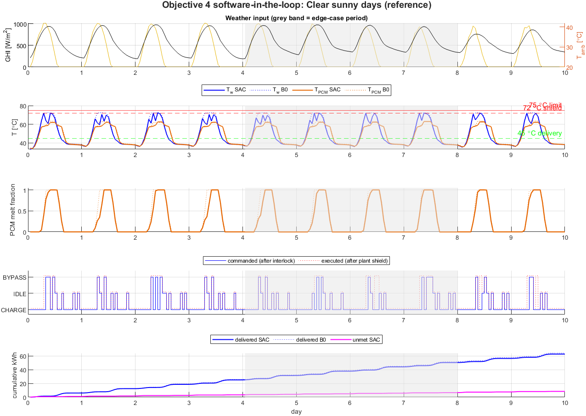
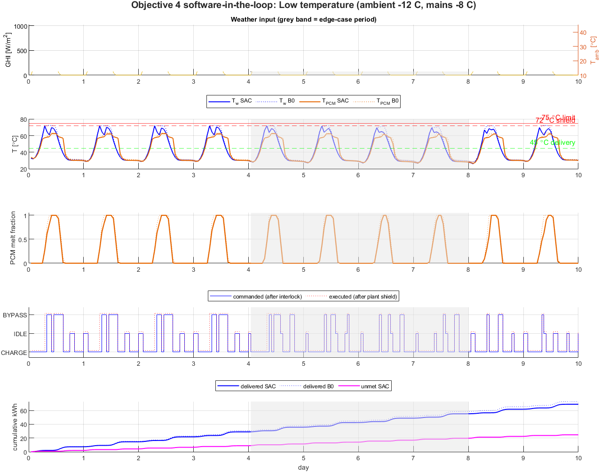
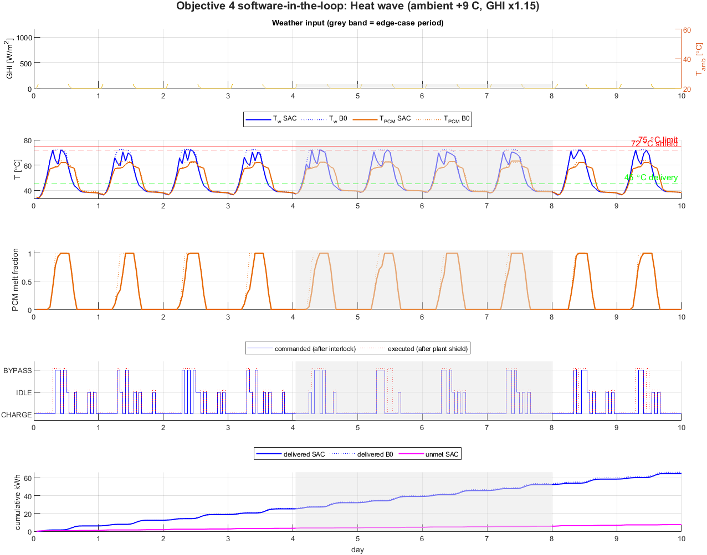
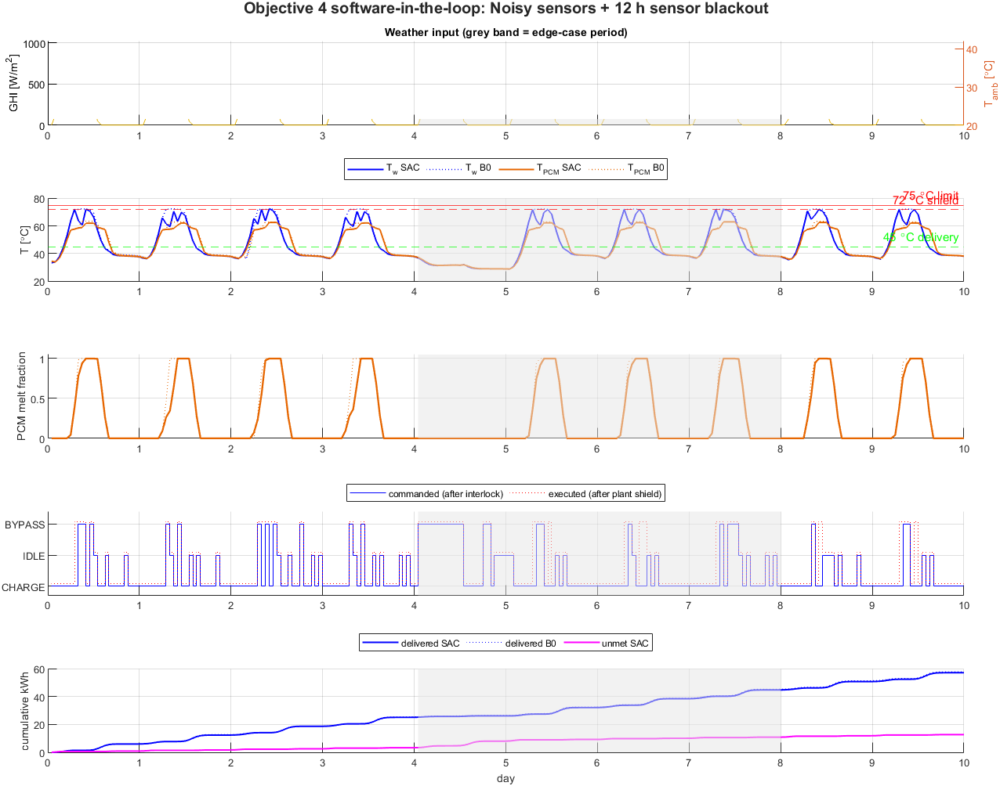
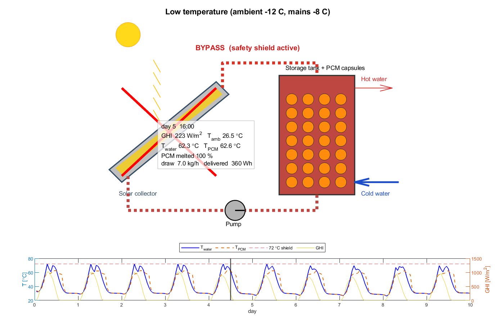

# Objective 4 – Points to Be Discussed

**One-line summary:** Real hardware is not available, so Objective 4 is done as a **software-in-the-loop (SIL) digital twin in MATLAB/Simulink**: the trained Objective 3 SAC controller is plugged into a simulated solar PCM water heater with noisy sensors and a safety interlock, and tested on normal and extreme weather. This is *emulated* validation, not experimental validation.

---

## 1. Objective 4 – Complete Explanation

### 1.1 What we are doing (5–7 points)

1. **Objective 4 is the deployment check of the Objective 3 controller.** The plan was an embedded rig (sensors, pump, valves, microcontroller) running the SAC policy. The hardware is not available this term.
2. **So we replace the hardware by a software replica of the whole control chain:** weather → sensors (with noise and dropout) → observation vector → SAC policy → safety interlock → pump/valve command → collector + water tank + PCM capsules → hot-water outlet.
3. **The trained SAC network is copied into MATLAB** as a plain function (its weights are exported from Python), so exactly the same decision-maker runs there.
4. **The plant is a line-by-line MATLAB port** of the Objective 2/3 physics, so the twin can be checked number-for-number against Python.
5. **We stress it with edge cases:** no sunlight, rain/heavy cloud, very low temperature, heat wave, and a sensor failure with a 12-hour blackout. Each is compared with the always-charge baseline (B0).
6. **We show it visually:** result plots for every case and an animated schematic (sun, collector, pump with moving water, tank colour by water temperature, PCM capsules changing colour as they melt).
7. **What it proves and what it does not:** it proves the controller and its safety logic behave correctly on the modelled system. It does not replace a physical field trial (step 6 of the Objective 4 test plan), which stays as future work.

### 1.2 Inputs and datasets

| Input | Source |
|---|---|
| Plant parameters (100 L tank, 2.5 m² collector, PCM mass, melting point, capsule geometry, safety limits 72 °C / 62 °C soft and 75 °C / 65 °C hard) | Objective 2 design + Objective 3 contract v3 (`export/plant_params.json`) |
| Weather: hourly irradiance (GHI), ambient temperature, hour of day, year 2011, 8760 h | Tamil Nadu weather data used by Objectives 2 and 3 (`export/weather_2011.csv`) |
| Hot-water demand profile (24-hour draw pattern) | Objective 2/3 demand model |
| Trained SAC controller weights (MLP 11-256-256-1) | Objective 3 (`results/sac/.../best_model.zip`, exported to JSON) |
| Python reference trajectory (for checking only) | Objective 3 environment run with the same policy |

The 2011 year is the held-out test year, not a training year. No new data was collected for Objective 4.

### 1.3 What exactly is implemented or simulated

- **Weather source** feeding hourly sunlight and air temperature.
- **Sensor model:** noise on irradiance (±10 W/m² + 1 %), and on air, water and PCM temperature (0.3 / 0.2 / 0.5 °C); 1 % random dropout; optional blackout.
- **Observation builder:** the same 11-number state vector the controller was trained on.
- **SAC policy:** outputs CHARGE, IDLE or BYPASS each hour.
- **Safety interlock:** stale sensor data forces BYPASS (fail-safe); a hard-limit breach latches a fault.
- **Plant:** collector (Hottel–Whillier), water node, PCM enthalpy model with melt fraction, wall heat capacity, tank heat loss, and a safety shield that acts every 150 s inside the hour.
- **Demand and outlet:** hot water drawn at the demand profile, cold mains water making up the volume.

### 1.4 Algorithms and methods, and why

| Method | Why used | Alternatives considered |
|---|---|---|
| **SAC (Soft Actor-Critic) controller**, selected in Objective 3 | Best trade-off: 97.7 % of the maximum heat delivery with 54 % fewer safety-shield trips | DQN (kept as an alternative), PPO, rule-based baselines |
| **Software-in-the-loop** twin | The only option without hardware; same code path as the later processor/hardware-in-the-loop stages | Hardware-in-the-loop (no hardware), ANSYS |
| **Enthalpy-method PCM model + Hottel–Whillier collector** | These are the models the policy was trained on; changing them would test a different system | CFD (too slow, not the trained plant) |
| **Sensor noise, dropout, stale-data interlock** | These are the realistic problems a real embedded controller meets | Ideal sensors (too optimistic) |
| **Line-by-line port and numerical comparison with Python** | Gives a hard proof that the MATLAB twin equals the simulator | Visual comparison only |

**Why not ANSYS?** The available ANSYS Student licence is Fluent only (no Twin Builder, no system-level co-simulation). It could calibrate PCM melting, but it cannot host a controller loop with sensors, pump and valves. MATLAB/Simulink does this directly.

### 1.5 Testing and validation

| Check | Result |
|---|---|
| Plant physics vs Python, full year 2011 (8760 h) | Max temperature difference about 1e-12 °C; shield trips equal (23,117); zero violations |
| SAC policy vs Python on Python's own observations | 100 % identical actions |
| Closed loop (sensors, observation, policy, interlock, plant), 14 days | 100 % identical actions; temperature difference about 1e-13 °C |
| Simulink model, 1 week | 100 % identical actions; temperature difference about 1e-13 °C |
| Regime 1 closed loop, 14 days | 100 % identical actions; shield trips 699 vs 699 |

### 1.6 How results were evaluated

For every scenario, the SAC controller and the always-charge baseline B0 run on the same weather, over an event window of 4 days (with 4 days before and 2 after). We compare:
- **heat delivered** to the user (kWh) and unmet demand,
- **safety-shield trips** (how often the controller drove the system into the guard band),
- **hard-limit violations** (must be zero),
- **lowest and highest water and PCM temperatures** and PCM melt fraction,
- **fail-safe hours** when sensors were lost.

### 1.7 Is Objective 4 fully completed?

**Yes for the software-in-the-loop scope. No for physical hardware.**

| Item | Status |
|---|---|
| Digital twin (Simulink + plain MATLAB) | Done, verified |
| Sensor noise / dropout / interlock | Done, tested |
| Six edge-case scenarios, regime 0 | Done |
| Edge-case scenarios, regime 1 | Done (see section 1.8); no animations for regime 1 |
| Animation of water movement and heating | Done for four cases (no sunlight, rain, low temperature, clear); minor cosmetic issues listed below |
| Regime 2 | Done: the twin now also supports the 15-input policy (3-hour sunlight forecast + next-hour demand), see section 1.8 |
| Generated C code of the controller (policy + interlock) | Done and checked against MATLAB (see `export*/codegen_verification.json`); this is **not yet a run on a real microcontroller** |
| Processor-in-the-loop on a target board / instruction-set simulator | Not done: needs a target board; future work |
| Hardware-in-the-loop / field trial | Not possible now; stays future work |

### 1.8 Actual final output (with explanation)

**Output files** are in `export/scenarios/` (regime 0) and `export_r1/scenarios/` (regime 1):
- one **result plot per scenario** (`clear.png`, `no_sunlight.png`, `rain_cloud.png`, `low_temperature.png`, `heat_wave.png`, `sensor_fault.png`),
- `scenario_summary.csv` (all numbers),
- **animations** (`*_animation.mp4`) and stills (`*_animation_frame.png`).

**Regime 0 results** (event = 4 days; delivered heat in kWh):

| Scenario | SAC delivered | B0 delivered | SAC shield trips | B0 shield trips | Hard violations |
|---|---|---|---|---|---|
| Clear | 25.3 | 25.8 | 321 | 920 | 0 |
| No sunlight | 1.3 | 1.3 | 0 | 0 | 0 |
| Rain / cloud | 4.6 | 5.2 | 0 | 0 | 0 |
| Low temperature | 26.2 | 27.9 | 142 | 380 | 0 |
| Heat wave | 27.3 | 27.9 | 340 | 1193 | 0 |
| Sensor fault | 19.6 | 19.8 | 280 | 664 | 0 |

**Regime 1 results** (second climate/design case, same scenarios, 98 capsules, 72 kg water; SAC model `results/sac/r1`):

| Scenario | SAC delivered | B0 delivered | SAC shield trips | B0 shield trips | Hard violations |
|---|---|---|---|---|---|
| Clear | 26.6 | 26.9 | 366 | 566 | 0 |
| No sunlight | 1.4 | 1.5 | 0 | 0 | 0 |
| Rain / cloud | 2.2 | 5.5 | 0 | 0 | 0 |
| Low temperature | 26.8 | 26.9 | 118 | 116 | 0 |
| Heat wave | 28.7 | 28.9 | 553 | 883 | 0 |
| Sensor fault | 20.7 | 20.9 | 247 | 416 | 0 |

Regime 1 agrees with the regime 0 pattern (near-equal heat, fewer shield trips, no hard violations, fail-safe works: 14 fail-safe hours for SAC, 17 for B0), with two honest exceptions: in **rain/heavy cloud SAC delivers much less than B0 (2.2 vs 5.5 kWh)** because it holds back charging in weak sun, and in the **cold case its shield trips are no lower than B0's (118 vs 116)**. These are policy weaknesses of the regime-1 model on conditions outside its training weather, and should be reported as limits (a candidate for retraining with such weather in the training mix).

**Regime 2 results** (15-input SAC, `r2_gen2_sac_r2_w10_s42`, 105 capsules, 70 kg water):

| Scenario | SAC delivered | B0 delivered | SAC shield trips | B0 shield trips | Hard violations |
|---|---|---|---|---|---|
| Clear | 26.6 | 26.6 | 753 | 818 | 0 |
| No sunlight | 1.2 | 1.2 | 0 | 0 | 0 |
| Rain / cloud | 4.8 | 4.8 | 0 | 0 | 0 |
| Low temperature | 28.2 | 28.7 | 307 | 430 | 0 |
| Heat wave | 28.8 | 28.8 | 1065 | 1073 | 0 |
| Sensor fault | 20.3 | **0.3** | 525 | 0 | 0 |

Regime 2's policy behaves almost like always-charge on most days, so it gains little against B0 except in the cold case. The sensor-fault row shows a **weakness of the interlock, not of the controller**. The interlock latches a fault the first time a measured temperature exceeds the hard limit (`safety_interlock.m`), and in this run the true temperatures stay below the limits, so the most likely cause is a single noisy reading (I did not trace the exact hour). The system then stayed in BYPASS for the remaining 182 hours (B0 then delivers almost nothing). A real design would add a debounce (for example three consecutive readings) and a manual reset; this is recommended as an improvement and is not yet implemented.

**Model choices.** Regime 0 uses `results/sac/r0` (the selected SAC). Regime 1 uses `results/sac/r1` (11-input), because the newer 15-input regime-1 model in the working folder had collapsed to always-CHARGE after its training was interrupted, and its committed version also behaves like always-charge. Regime 2 uses the committed 15-input model, the only regime-2 SAC available. If you retrain, re-export (command at the end).

**How to read the regime 0 table:**
- On sunny, cold and hot days SAC delivers **within about 2–6 % of B0 while cutting shield trips by roughly 55–72 %**. That is the controller's job: nearly the same heat, far fewer excursions into the guard band.
- With **no sunlight** (and in rain) there is nothing to store, so both strategies deliver about the same; the system simply falls back to mains-temperature water with no overheating risk. Small deliveries (1.3 kWh) are heat left over at the start of the window.
- **Low temperature:** the collector still works in daylight; heat loss rises slightly; no violation.
- **Heat wave:** the highest risk of overheating; SAC has 340 shield trips against 1193 for B0 with zero hard violations.
- **Sensor fault:** during the 12-hour blackout the interlock forces BYPASS (14 fail-safe hours for SAC, 17 for B0), so the system fails safe, then recovers when data returns.

**Result plot:** each PNG has five panels: weather input (the grey band marks the edge-case period), water and PCM temperature against the 45 °C delivery line and the 72 °C / 75 °C limits, PCM melt fraction, commanded and executed action, and cumulative delivered and unmet energy.

**Animation:** the collector, pump and pipes show hot and cold flow, the tank colour follows water temperature, the capsules go from blue (solid) to orange (melted), the heater state (CHARGE / IDLE / BYPASS and the safety-shield flag) is written on screen, and a trend strip underneath follows the simulated day.







**Findings worth stating:**
- In this design the PCM is fully solid again by about midnight every day. No stored heat carries into the next morning, so the "night heat" benefit of PCM is small for this sizing. This is a real design finding for the report.
- The controller never reaches the hard limits (75 °C water / 65 °C PCM) in any scenario.

**Limits:** regime 0 and 1 only; emulated, not experimental; rain enters only as less sunlight and cooler air; the policy decides hourly while the hardware spec says a 10 s control cycle; animation pump icon shows running whenever CHARGE is commanded even in very low sun, and some labels overlap with pipes.

---

## 2. Why MATLAB?

### 2.1 Why we chose MATLAB for Objective 4

- **Simulink is the standard tool for hardware-like simulation.** It lets us build the same signal chain as the real rig (weather, sensors, controller, interlock, pump, plant) as blocks, with sample times like the real system.
- **It is the planned route to hardware.** The same model can later generate C code (Embedded Coder) for a microcontroller and be used for processor-in-the-loop and hardware-in-the-loop.
- **ANSYS was not suitable:** the student licence cannot run controller co-simulation, and CFD is far too slow for year-long closed loops.
- **Sunlight, water flow, heat transfer and PCM melting are all expressible in MATLAB**, and so are animations and plots, so one tool covers modelling, testing and presentation.
- **MATLAB is available on the lab machine** (R2023b with the needed toolboxes).

### 2.2 What exactly we implement or simulate in MATLAB

The complete chain in section 1.3: weather → sensors → observation → SAC → interlock → pump/valve → collector + tank + PCM → outlet, run as a plain MATLAB closed loop and as a Simulink model, plus scenario studies, plots and animation.

---

## 3. Libraries, Implementation and Output

### 3.1 MATLAB products used

| Product | Purpose | Why this one |
|---|---|---|
| **MATLAB (base)** | Plant physics, policy, sensor model, interlock, scenarios, plotting, MP4 animation (`VideoWriter`, graphics) | Core language; everything is plain functions, easy to compare with Python |
| **Simulink** | The block-diagram digital twin (`pcm_drl_twin.slx`) with weather, sensors, agent, interlock, plant and scopes | Hardware-like signal flow with real sample times |
| **Stateflow** (via MATLAB Function blocks) | Hosts the MATLAB Function blocks that contain the plant and policy code | Required by Simulink MATLAB Function blocks |
| **Embedded Coder / MATLAB Coder** (available, not yet used) | Would generate C code for a microcontroller (processor-in-the-loop) | Planned next step |
| **Reinforcement Learning Toolbox** (available, not used) | Not needed, because the trained network is exported to plain matrices instead | Avoids importing the Python model through ONNX |

Python is used only for the one-time export of parameters, weather and policy weights (`export_from_python.py`), and for the reference run used in the comparison.

### 3.2 What the simulation demonstrates

- The trained controller **runs correctly outside Python**, in a hardware-like loop.
- It **keeps the system within safety limits** under no sun, rain, cold, heat and sensor failure.
- The **fail-safe logic works**: lost sensors lead to BYPASS and the controller recovers afterwards.
- It **keeps nearly the same heat output as the always-charge baseline while cutting safety-shield trips**.
- It gives a **visual picture** of water movement, heating and PCM melting.

### 3.3 Is the expected output generated?

Yes. The plots and the summary table exist for regime 0 and regime 1 (all six scenarios each); animations exist for regime 0 (four cases). Regime 1 is in `export_r1/scenarios/`. The Simulink model builds and runs (slowly: about 11 s per simulated hour, so it is used for the one-week check; the plain MATLAB loop produces identical numbers for long runs).

### 3.4 Has the output been tested and verified?

Yes, against the Python simulator (see section 1.5): plant physics for a full year, policy actions, closed loop and the Simulink model, all with 100 % identical actions and temperature differences around 1e-13 °C. Results of the scenarios are produced by that verified code. What has **not** been verified is behaviour on real hardware.

---

## How to reproduce

```bash
# from objective3/
python objective4_software_in_loop/export_from_python.py --regime 0 --year 2011 --hours 8760
python objective4_software_in_loop/export_from_python.py --regime 1 --year 2011 --hours 8760 --out objective4_software_in_loop/export_r1 --model results/sac/r1/best_model/best_model.zip
```
```matlab
cd objective4_software_in_loop/matlab
run_scenarios                          % regime 0, with animations
regime = 1; doAnim = false; run_scenarios   % regime 1
```
